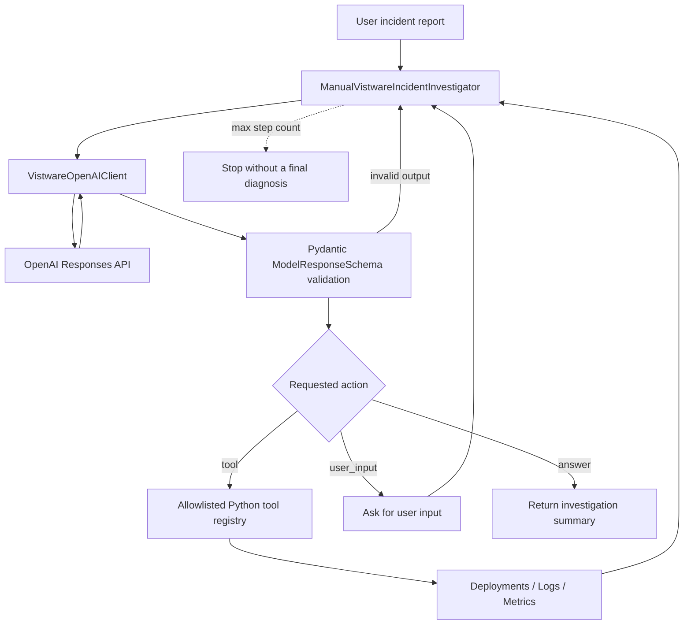

# Module 01 — Building an AI Agent Loop Manually

> **Educational engineering notes · Python 3.14 · OpenAI Python SDK · Pydantic v2**
>
> This module demonstrates the internal mechanics of an AI agent **without using an agent framework**. It is a learning exercise, not a production-ready incident response system.

## 1. Purpose

The objective is to understand what an agent framework normally handles behind the scenes:

- calling a language model and interpreting its response;
- allowing the model to choose an action;
- dispatching that action to an explicitly registered Python function;
- returning the function's result to the model;
- preserving conversation context across successive model calls;
- validating model output and handling errors;
- stopping execution and cleaning up resources.

The example is called **Vistware Incident Investigator**. A user reports HTTP 500 errors after a deployment. The agent can inspect **synthetic** deployment history, application logs and service metrics, then report a possible explanation.

**This implementation uses the low-level `openai` Python SDK and Pydantic. It does not use `pydantic-ai.Agent`, `openai-agents`, or native OpenAI function calling.** Pydantic AI is the subject of subsequent modules. Implementing the loop manually first helps explain *why* the higher-level abstractions exist.

The repository intentionally does not use an `AGENTS.md` file: the exercises are designed to encourage independent engineering and debugging rather than delegation to a coding agent.

## 2. Components

| File | Responsibility |
| --- | --- |
| `main.py` | Starts the example and prints the investigation result. |
| `settings.py` | Loads API credentials, model name and logging settings with `BaseSettings`. |
| `dependencies.py` | Initializes logging for the module. |
| `clients.py` | Encapsulates the OpenAI client, a conversation ID, API calls and conversation cleanup. |
| `schemas.py` | Defines domain models, possible agent actions and Pydantic validation rules. |
| `tools.py` | Provides three read-only, synthetic investigation functions. |
| `exceptions.py` | Defines domain-specific exceptions. |
| `agents.py` | Implements the manual orchestration loop and tool dispatch. |

Shared helpers under `agents_lab.utils` provide logging and type definitions. The file names above describe the reviewed module; this documentation does not imply the code has been independently executed or that automated tests already exist.

## 3. High-level architecture



The model **does not directly execute Python code**. It generates an action proposal in JSON. The application validates the response, resolves the tool name against a registry, and executes the selected callable.

### The three supported actions

| Action | Expected fields | Runtime behavior |
| --- | --- | --- |
| `tool` | `tool_name`, `tool_args`, `reason` | Invoke an allowed tool and send its result back to the model. |
| `user_input` | `output`, `reason` | Display a question in the terminal and pass the user's answer to the next iteration. |
| `answer` | `output`, `reason` | End the investigation and return the model's explanation. |

Only one action is expected per model response. The current schema uses `@model_validator(mode="after")` to reject contradictory combinations, such as `action="answer"` with a tool name or `action="tool"` without tool arguments.

## 4. The manual agent loop, step by step

1. `main.py` initializes logging and creates `ManualVistwareIncidentInvestigator(user_problem=...)`.
2. The investigator builds an **allowlist** of three Python functions and includes their docstrings and response schemas in the model instructions.
3. `VistwareOpenAIClient` creates an OpenAI conversation lazily on the first request.
4. The investigator sends the initial problem using `responses.create(...)`, passing the same instructions on each call.
5. The response text is parsed with `ModelResponseSchema.model_validate_json(...)`. Pydantic checks the shape and the action-specific rules.
6. For a `tool` action, the application looks up a callable in its registry, invokes it, and sends a textual representation of the result as the next input.
7. For `user_input`, the application requests information from the terminal. For `answer`, it returns the response.
8. A maximum-step counter limits loop iterations, including attempts that fail Pydantic validation. When the loop exhausts the limit without a final answer, it returns `None`.
9. The outer `investigate()` method handles selected errors and calls conversation deletion in `finally`.

### How context is preserved

The client passes the same `conversation` identifier on subsequent Responses API calls. Conversation items are added to the conversation and provided as context on later requests. This fixes a common beginner error: sending only the *most recent* tool result and accidentally losing the original task and earlier evidence.

**Important distinction:** in this demo, tool results are sent back as ordinary text in `input`. They are **not** native `function_call_output` messages with linked call identifiers. This is a deliberate simplification to expose the mechanics of the loop.

### Instructions versus input

- `instructions`: comparatively stable role, safety expectations, tool descriptions and output-format requirements.
- `input`: the current user request, result from a tool, validation feedback or additional user information.
- `conversation`: the session context shared across calls.

The demo sends its instructions for each request rather than assuming they are permanently attached to the conversation.

## 5. Synthetic investigation scenario

All records are fictional and deterministic: no production system, monitoring backend or customer environment is accessed.

**Configured service:** `my_service`.

| Timestamp (2026-11-02) | Simulated event |
| --- | --- |
| 12:00:00 | Previous deployment marked successful. |
| 14:00:00 | New deployment marked failed; old deployment stopped. |
| 14:00:20 | Warning about low disk space. |
| 14:00:40 | Database authentication error. |
| 14:00:45 | Service restart. |
| 14:00:50 | Attempt to restore the old deployment fails, again citing database authentication. |

The example metrics include **95% disk usage** and **`password_expires_in = 0`**. These measurements provide additional investigation clues.

A defensible answer should treat a database credential problem as a **strong hypothesis**, not a conclusively proven root cause. High disk usage may be a concurrent risk. Temporal correlation with the deployment does not, by itself, prove that the deployment changed the database password.

### Deliberate design choice: service lookup

The author deliberately uses different lookup behavior in the mock tools: deployment and log tools validate the requested service through `get_service_by_name()`, while the metrics tool does not perform that same lookup. **This is an intentional architectural choice in the exercise, not an accidental omission.** Its underlying rationale is not documented here; readers should not infer that this difference is a universal production recommendation. In a real system, each tool's authority, source of truth and service-identity semantics would need to be specified and tested.

## 6. Validation: what Pydantic does and does not guarantee

Pydantic provides two distinct safeguards:

1. **Field validation:** the returned JSON must contain fields of the expected types (for example, a recognized `ActionType`).
2. **Cross-field validation:** `@model_validator(mode="after")` checks rules that depend on the selected action.

The application catches `ValidationError` and asks the model to try again. Such retries count toward the step limit.

However, **Pydantic validation is not equivalent to factual correctness, authorization or secure execution**. Also, Python-level `model_validator` logic is not automatically expressed by `model_json_schema()`; the model may still generate a JSON object that is syntactically valid but rejected by the runtime validator.

The example includes schema information in natural-language instructions. It **does not enforce native API Structured Outputs**, and its prompt-described tools are **not native Function Calling**. These two distinctions matter when comparing the manual implementation with production-grade frameworks.

## 7. Known risks and deliberate scope limitations

> **Maintainer's note:** I am aware of the following risks and engineering trade-offs. They are documented openly because this repository is an educational demonstration of manual agent orchestration. Their presence **does not mean they are safe for production** or that mitigations have already been implemented. Some decisions, including the differing service-lookup behavior, are intentional and kept within the boundaries of the example.

| Risk / limitation | Current demonstration | Production-oriented expectation |
| --- | --- | --- |
| **Prompt injection** | Tool outputs and log messages are included in model-visible text. Instructions tell the model to distrust them, but that is not a security boundary. | Treat external content as untrusted, enforce permissions in application code, and test malicious tool outputs. |
| **Model-generated arguments** | The LLM proposes a tool name and a dictionary of string arguments. | Validate each tool's arguments against a typed schema and enforce limits before calling the function. |
| **Tool execution errors** | The dispatcher handles unknown tools and some argument-related exceptions. Error classification is intentionally coarse. | Distinguish bad model input from tool implementation failures, infrastructure failures and retryable errors. |
| **Broad exception handling** | The outer boundary catches unexpected exceptions and may return `None`. | Preserve exception details in diagnostics and return explicit, typed failure states. |
| **Ambiguous termination** | Reaching the step limit yields no final diagnosis, represented by `None`. | Report explicit statuses such as `completed`, `max_steps_exceeded`, `invalid_output` or `failed`. |
| **Cost and rate limits** | There is a fixed loop-step limit, but no complete token, cost, latency or retry budget. | Enforce timeouts, token/cost budgets, concurrency limits and bounded retries. |
| **Structured outputs** | JSON is requested via instructions and validated after generation. | Consider API-enforced structured output when supported, with runtime validation retained. |
| **Native tool protocol** | Tool dispatch is implemented through JSON actions and text messages. | Consider native Function Calling and correlated tool-call outputs. |
| **Secrets and logs** | Environment secrets use `SecretStr`, but debug logs can contain prompts or tool results. | Redact sensitive values, avoid excessive logging and apply access controls and retention policies. |
| **Conversation storage** | A conversation is created, reused and deleted through the API. | Design retention, deletion, audit and privacy controls explicitly; do not equate deleting a conversation object with guaranteed erasure of every related item. |
| **Terminal-only interaction** | `input()` is used for follow-up questions. | Use an application-level pause/resume or approval mechanism in a web or distributed system. |
| **Data correctness** | Synthetic records support learning; timestamps are naive datetimes and metrics are not fully range-constrained. | Use timezone-aware timestamps, validated metrics, consistent domain contracts and trusted monitoring data. |
| **Testing** | The mock incident is repeatable, but this document makes no claim of an existing comprehensive test suite. | Add unit, integration, adversarial and evaluation tests, including negative and timeout scenarios. |

**Two practical details in the current sample:**

- The log tool converts `limit` from a string to an integer and uses list slicing; negative values, invalid integers and unexpectedly large values need a deliberate input policy.
- `delete_conversation()` is called from `finally`; a cleanup failure can itself raise an exception and potentially obscure the main outcome. Cleanup errors need their own policy in production.

## 8. Why this is not a production framework

The purpose is **not** to build a replacement for Pydantic AI or OpenAI Agents SDK. The exercise intentionally exposes decisions that frameworks typically help manage: output validation, tool contracts, state transitions, retries, conversation state, observability and termination.

There is no claim that the sample provides secure multi-tenancy, durable job execution, production authorization, independent incident verification or reliable automated root-cause analysis.

The application is **read-only** in its intended tool design. It does not deploy changes, restart services, rotate credentials or perform rollbacks. Even read-only operations require authorization in real customer environments.

## 9. How to run the demonstration

From the project root, after installing the dependencies and configuring an API key:

```bash
uv sync
uv run --env-file .env python -m agents_lab.module_01.main
```

The `.env` file must not be committed. Configure the settings required by `Module01Settings`, including `OPENAI_API_KEY` and `AI_MODEL`. API calls can incur charges, independently of a ChatGPT subscription.

The module targets **Python 3.14**. For example, the following syntax is valid under [PEP 758](https://peps.python.org/pep-0758/):

```python
except TypeError, AttributeError, ValueError:
    ...
```

Older Python versions require parentheses around the exception types.

## 10. Suggested experiments for readers

1. Make the model request an unknown tool and observe the dispatcher's response.
2. Supply missing, non-numeric or negative `limit` values and observe the different error paths.
3. Return an invalid JSON object and verify that the retry consumes the step budget.
4. Inspect the context across several iterations and verify that prior evidence remains available.
5. Inject misleading instructions into a synthetic log and confirm why prompt-only defenses are insufficient.
6. Test what happens when API communication or conversation cleanup fails.
7. Compare the manually written loop with an equivalent Pydantic AI agent in a later module.

Readers are encouraged to implement and test their own solutions instead of copying a complete production abstraction into this module.

## 11. Lessons learned

- **An LLM proposes actions; application code executes them.**
- **Conversation history is not optional** for multi-step reasoning across observations.
- **An allowlist is necessary but not sufficient**: arguments, permissions and side effects still need validation.
- **Structured data is not automatically trustworthy** just because it passed a schema.
- **Every model call needs boundaries**, including retries after malformed responses.
- **The right amount of AI is often less than expected**: deterministic rules should remain deterministic.
- **Understanding the manual loop first** makes a higher-level framework easier to evaluate and use responsibly.

## References

- [OpenAI — Responses API](https://developers.openai.com/api/reference/resources/responses/methods/create)
- [OpenAI — Conversation state](https://developers.openai.com/api/docs/guides/conversation-state)
- [OpenAI — Conversations API](https://developers.openai.com/api/reference/resources/conversations/methods/create)
- [Pydantic — Models and validation](https://pydantic.dev/docs/validation/latest/concepts/models/)
- [Pydantic — JSON Schema](https://github.com/pydantic/pydantic/blob/main/docs/concepts/json_schema.md)
- [Python — PEP 758](https://peps.python.org/pep-0758/)

---

**Vistware AI Agents Lab** · An educational exploration of agent engineering, architecture, reliability and security.
