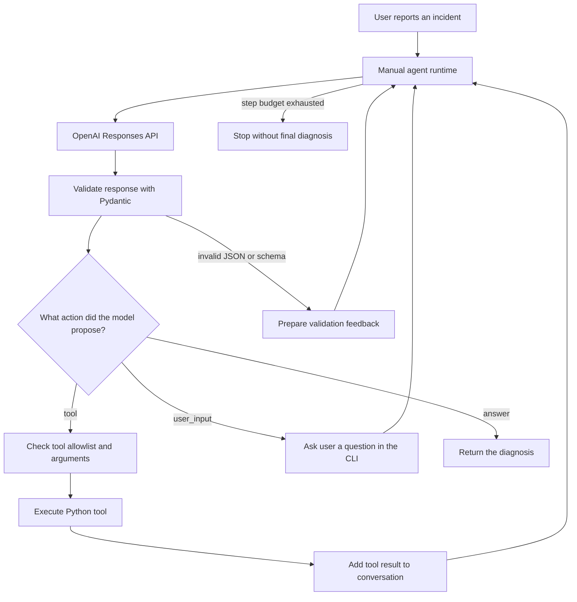

# Module 01 — Build an AI Agent Loop from Scratch

> **Vistware AI Agents Lab · Python 3.14 · OpenAI Python SDK · Pydantic v2**  
> **Learning path:** Module 00 → **Module 01: Manual Agent Loop** → Module 02: Pydantic AI

**What happens when an AI agent calls a tool? Who executes the code? How does the model remember previous steps? And what stops it from running forever?**

This guide answers those questions by walking through a small AI agent built **without an agent framework**. Rather than hiding orchestration inside a library, the example exposes the decisions an engineering team must make to build an agent that interacts with real software.

The project is deliberately educational. All incident data is synthetic. The implementation is **not a production-ready incident response system**, and its security and reliability limitations are documented openly.

**[Vistware](https://vistware.com) · [OpenAI Responses API](https://developers.openai.com/api/docs/guides/conversation-state) · [Pydantic](https://docs.pydantic.dev/latest/)**

---

## 1. Who is this guide for?

This module is designed for Python developers who understand functions, exceptions, type annotations and HTTP APIs, but are new to building AI agents.

You do **not** need experience with Pydantic AI, LangGraph or OpenAI Agents SDK. In fact, the point of this exercise is to understand what those frameworks usually do for you.

### By the end, you should be able to explain

- Why an LLM is **not** an agent by itself.
- How a model proposes an action without executing Python code.
- How an application validates and dispatches a tool call.
- Why multi-step investigations require conversation state.
- What Pydantic can validate, and what it cannot.
- How an agent stops, retries, asks for input or fails.
- Which design choices belong to the model and which must stay in application code.

> **Learning philosophy:** Read, experiment, form a hypothesis, break something safely, and inspect what actually happened. This repository intentionally does not contain `AGENTS.md` because the exercises are intended to develop independent engineering judgment—not delegate the exercise to a coding agent.

---

## 2. Before writing code: do we even need an agent?

Imagine three requests:

| Request | Typical solution | Why |
| --- | --- | --- |
| “Calculate the number of overdue invoices.” | SQL + deterministic Python | Rules and expected output are well defined. |
| “Summarize this incident report.” | A single LLM call | The model generates text, without taking actions. |
| “Investigate why a service started returning HTTP 500 after deployment.” | Potentially an agent | Which evidence is needed may depend on what earlier tools reveal. |

**Use an agent when adaptive decision-making adds value.** A multi-step task alone does not justify an agent; a conventional workflow is often cheaper, faster, safer and easier to reason about.

This module uses the third scenario because it naturally invites decisions such as:

1. Are deployment details needed?
2. Should application logs be checked next?
3. Do the logs justify checking metrics?
4. Is there sufficient evidence for a diagnosis, or should we ask for clarification?

The model can propose the sequence, but your Python application remains in charge of execution.

### LLM, agent, runtime: three distinct concepts

- **LLM:** produces a response from the information it receives.
- **Agent:** a system that uses an LLM to decide what to do next, often with tools and repeated steps.
- **Runtime (or orchestrator):** the software that calls the model, validates its decisions, runs permitted tools, manages state and enforces boundaries.

**Key principle:** the model *requests* an action; the runtime *executes or rejects* it.

---

## 3. The demonstration: Vistware Incident Investigator

A user reports:

> After the latest deployment, the application started returning HTTP 500 errors. Investigate what might have gone wrong and provide a diagnosis.

The investigator has access to three read-only **mock tools**:

| Tool | Purpose |
| --- | --- |
| `get_recent_deployments(service)` | Retrieve the service's deployment history. |
| `get_recent_logs(service, limit)` | Retrieve a limited number of application logs. |
| `get_service_metrics(service)` | Retrieve synthetic operational measurements. |

The tools return typed Pydantic models such as `RecentDeployment`, `LogEntry` and `ServiceMetric`. No production cluster, monitoring backend or real customer database is contacted.

### Evidence the mock environment contains

| Time on 2026-11-02 | Event / signal |
| --- | --- |
| 12:00:00 | Earlier deployment succeeded. |
| 14:00:00 | New deployment is recorded as failed. |
| 14:00:20 | A low-disk-space warning appears. |
| 14:00:40 | Application log reports an invalid database password. |
| 14:00:50 | Restoring the old deployment also fails with a database authentication error. |
| 14:00:00 (metrics) | Disk usage is 95%; `password_expires_in` is `0`. |

**How should we interpret this?** A database credential problem is strongly supported by the available evidence. But we cannot prove from these records alone that the deployment changed the password, nor that disk pressure caused the HTTP 500 responses. Good diagnostic output distinguishes evidence, interpretation and uncertainty.

---

## 4. Architecture: what happens inside a manual Agent Loop?



The important distinction is **where each arrow runs**:

- The **model** determines the next requested action.
- **Pydantic** checks whether a response matches the expected data contract.
- The **runtime** chooses which Python callable can actually execute.
- The **tool** returns evidence to be considered in the next model step.
- The **application** controls iteration limits and cleanup.

### A model response is not executable code

The manual approach in this module asks the model to produce a JSON object describing one of three actions. For illustration:

```json
{
  "action": "tool",
  "tool_name": "get_recent_logs",
  "tool_args": {
    "service": "my_service",
    "limit": "7"
  },
  "output": null,
  "reason": "Application logs may explain the new HTTP 500 errors."
}
```

This JSON does **not** call `get_recent_logs` by itself. The Python runtime must interpret it, check the requested name against its registered functions and then invoke the function with validated arguments.

This project uses **manual JSON-based tool dispatch** intentionally. It is **not the native OpenAI Function Calling protocol**. Native Function Calling uses separate tool-call and tool-result structures; we will compare these approaches with a framework in Module 02.

---

## 5. Explore the repository: responsibility by file

The implementation for this lesson lives under `agents_lab/module_01/`.

| File | What to look for | Question to ask yourself |
| --- | --- | --- |
| `main.py` | The CLI entry point and initial problem | Where does the investigation begin and end? |
| `settings.py` | `BaseSettings`, `SecretStr`, model and logging config | Where are secrets loaded? |
| `dependencies.py` | Logging initialization | Which setup belongs outside the agent? |
| `clients.py` | OpenAI client and conversation lifecycle | Who owns an API conversation? |
| `schemas.py` | Typed records and model action schema | Which invalid states can be rejected? |
| `tools.py` | Synthetic diagnostic data and read-only functions | What can the model request, and what does it *not* control? |
| `exceptions.py` | Domain-specific errors | What is a domain problem versus a runtime failure? |
| `agents.py` | Manual loop, routing, retries and input handling | Where does model judgment stop and application control begin? |

Shared utilities may live in `agents_lab/utils/`. The purpose of the separation is to make the data models, external API adapter, orchestration and diagnostic tools understandable independently.

**A useful exercise:** before opening `agents.py`, try to draw the flow of one request using only the table above. Then compare your drawing with the actual control flow.

---

## 6. Run the example

### Requirements

- Python **3.14**
- [`uv`](https://docs.astral.sh/uv/)
- An OpenAI API key with access to a suitable model

From the repository root:

```bash
uv python install 3.14
uv sync
```

Create a local `.env` file based on the repository's example configuration. At minimum, `Module01Settings` expects:

```dotenv
OPENAI_API_KEY=replace_with_your_key
AI_MODEL=openai:your-supported-model
LOG_LEVEL=DEBUG
```

Use a **real supported model identifier** for `AI_MODEL`. The `openai:` prefix is a naming convention used by the sample configuration; the low-level OpenAI SDK requires the actual model ID.

Run the lesson:

```bash
uv run --env-file .env python -m agents_lab.module_01.main
```

You should see debug information about agent steps, followed by either a diagnosis or an explicit message that the investigation did not produce one. Exact wording, tool choices and token usage may vary by model and run.

**Do not commit `.env` or API credentials.** API calls can generate charges. A ChatGPT subscription does not by itself make general API usage free.

---

## 7. The core concepts, explained through the code

### 7.1. Model output: `tool`, `user_input` or `answer`

The first version of the runtime needs a small, explicit vocabulary for model decisions:

| Action | Meaning | Runtime responsibility |
| --- | --- | --- |
| `tool` | “I need more evidence.” | Resolve and execute an approved function. |
| `user_input` | “I need a missing piece of information.” | Ask the person using the CLI, then continue. |
| `answer` | “I can now provide a diagnosis.” | Return the final explanation. |

The action is represented by an enum, while a Pydantic model represents the associated fields. An action-specific validator rejects contradictory combinations.

For example, `action="answer"` without a nonempty `output` should not be considered a meaningful finished result. A `tool` action should include a valid tool name and an arguments object.

**What Pydantic guarantees:** field types and rules that you explicitly define.  
**What Pydantic does not guarantee:** that the proposed tool is authorized, that a diagnostic conclusion is true or that a tool result is trustworthy.

### 7.2. Why the tool allowlist matters

The runtime maintains a mapping from approved names to Python functions. This is the boundary between a model suggestion and executable application code.

Conceptually:

```python
allowed_tools = {
    "get_recent_deployments": get_recent_deployments,
    "get_recent_logs": get_recent_logs,
    "get_service_metrics": get_service_metrics,
}
```

A request for `delete_database` must **not** somehow resolve to an arbitrary Python function. Even if the model invented that name confidently, it does not become an available capability.

However, an allowlist is only the beginning. The runtime must also consider argument validation, access control, side effects, rate limits and exception handling.

### 7.3. Tool descriptions: how does the model know what exists?

In this manual implementation, the runtime collects the functions' names and docstrings and includes them in instructions sent to the model. It also describes the expected returned data using Pydantic schemas.

This is deliberately explicit so readers can see the contract being constructed. A higher-level framework often generates tool schemas from function signatures and docstrings automatically.

**Engineering lesson:** clear tool names and precise argument descriptions reduce ambiguity, but descriptions are not a substitute for runtime validation.

### 7.4. `instructions` versus `input`

The example uses the Responses API with two conceptually different pieces of information:

- **`instructions`:** how the investigator should behave—its role, scope, available actions and expected response shape.
- **`input`:** what the model should consider on the current step—the incident report, a tool result, validation feedback or a user's clarification.

The demo sends stable instructions with each API call. It does not rely on an implicit, permanently installed system prompt.

### 7.5. Conversation state: why the original problem must survive

A common early bug in manual agent loops looks like this:

1. The model receives the initial incident report.
2. A tool runs.
3. The next model request contains **only** the most recent tool output.
4. The model no longer has guaranteed access to the original user goal or earlier evidence.

The example addresses that by creating an OpenAI conversation and passing its ID on subsequent Responses API requests.

A shortened illustration:

```python
conversation = client.conversations.create()

response = client.responses.create(
    model=model_name,
    instructions=agent_instructions,
    input=current_input,
    conversation=conversation.id,
)
```

The **conversation object** is a way to maintain history across calls; it is not a Python function call, and it does not replace application-level authorization or state management.

**Important:** the example sends tool results as ordinary text input. It is not using native, call-ID-correlated `function_call_output` messages. That distinction matters for provenance, clarity and robust orchestration.

### 7.6. Validation failure: repair or stop?

The model may return malformed JSON, omit a required field or produce an inconsistent combination of action and data. Pydantic raises `ValidationError` when validation fails.

The educational runtime can send validation feedback back to the model and ask it to try again. **Every attempt must consume the execution budget**, including attempts that fail to produce a valid response.

Otherwise a simple `continue` can turn a bounded loop into an effectively unbounded sequence of paid API calls.

### 7.7. When does the agent stop?

The manual loop terminates when:

- the model returns an `answer` action;
- the step budget is exhausted;
- an unrecoverable error occurs.

The terminal `user_input` action is a **CLI interaction**: the program waits for a person to type a value. It is not a distributed, durable human-in-the-loop workflow.

The educational example may return `None` when no diagnosis is reached. Production systems should distinguish reasons such as `max_steps_exceeded`, `tool_failed`, `invalid_response` and `completed`.

### 7.8. Resource lifecycle

A conversation is created lazily, reused during an investigation and has a cleanup path. This is useful for understanding ownership of remote resources.

However, deleting a conversation object should **not** be equated with proving that every associated record has been erased from every location. Retention and deletion semantics must be checked against current provider documentation and the needs of the application.

---

## 8. Read the diagnosis critically

Given the synthetic evidence, a useful investigation might conclude:

> The evidence strongly suggests a database authentication problem. The service logs report an invalid database password and the password-expiry metric is zero. A failed rollback appears to be affected by the same issue. Disk usage is also high, but available logs do not establish it as the cause of the HTTP 500 responses.

This is an **illustrative interpretation**, not a guaranteed model output.

Before accepting any automated diagnosis, ask:

- **Evidence:** Which specific log line or metric supports the claim?
- **Causality:** Is the explanation established, or merely correlated with an event?
- **Alternatives:** Could another condition produce the same symptoms?
- **Missing signals:** What evidence would confirm or reject the suspected cause?
- **Action safety:** Is the suggested next step safe, authorized and reversible?

A fluent answer is not necessarily a correct answer. Agent engineering includes designing ways to tell the difference.

---

## 9. Known limitations and security risks — acknowledged deliberately

> **Maintainer's note**  
> This module is an educational demonstration of **manual agent orchestration**. I am aware of the following risks and limitations. They are disclosed intentionally so learners understand the engineering trade-offs. Documenting them does **not** mean they are solved, safe to ignore or acceptable in a real customer environment.

| Area | What this lesson demonstrates | What a production design would also need |
| --- | --- | --- |
| **Prompt injection** | Log contents are returned to the model, and instructions tell it not to follow embedded commands. | Enforced trust boundaries, authorization and adversarial evaluation; prompts alone are not protection. |
| **Tool allowlisting** | A fixed registry prevents arbitrary tool names from resolving. | Per-user/tenant access checks, strict typed arguments and limits before executing functions. |
| **Tool argument errors** | Basic handling of missing or invalid arguments. | Per-tool validation and a distinction between bad model input and internal tool defects. |
| **Untrusted conclusions** | Pydantic validates structure, not diagnostic truth. | Evidence verification, uncertainty reporting and domain-specific review. |
| **JSON via prompting** | Instructions request a JSON action, validated after generation. | API-enforced Structured Outputs where suitable, plus application-side validation. |
| **Manual tool protocol** | Python interprets `action="tool"` and a dictionary of arguments. | Native Function Calling and correlated results where appropriate. |
| **Unbounded execution/cost** | A maximum number of loop iterations, including validation retries. | Additional request/token/cost/time budgets, throttling and bounded retry policies. |
| **Errors and termination** | Simple exception handling; a non-answer can become `None`. | Explicit failure states, monitoring, actionable diagnostics and reliable cleanup. |
| **Conversation and privacy** | A conversation is created, reused and deleted via the API. | Intentional storage/retention policies, PII handling, data residency review and deletion semantics. |
| **Secrets and debug logs** | `SecretStr` protects the secret's ordinary representation. | Redaction of prompt/tool contents, secure access to logs and disciplined secret lifecycle. |
| **Human interaction** | `input()` allows clarification in a terminal. | Nonblocking pause/resume, approval workflows and durable state in services or workers. |
| **Mock data** | Read-only functions return synthetic records. | Real source-of-truth contracts, error handling, timezone-aware timestamps and auditability. |
| **Testing** | Deterministic data makes manual comparison easier. | Automated tests, adversarial inputs, regression evaluations and behavior monitoring. |

### Two subtle risks worth investigating

**1. A valid Python type is not always a valid domain value.** A log `limit` may be an integer but still be negative or unreasonably large. Similarly, `cpu_usage=200` is a float but not a meaningful percentage. Domain constraints need explicit validation.

**2. Cleanup can fail too.** If deleting a remote conversation raises an exception inside `finally`, that exception may obscure the main investigation result. A robust system defines a separate cleanup-error policy.

The sample uses no production credentials beyond the local API key needed to contact the model. It must never be connected to real customer systems without a fresh security and architecture review.

---

## 10. Six hands-on experiments

Try these locally using only synthetic data. You will learn more by observing the failures than by copying a completed implementation.

### Exercise 1 — Unknown tool

Make a model response request a function that is **not** present in the registry.

**Observe:** Does the application reject the request? Can the model recover? Is any unexpected code executed?

### Exercise 2 — Invalid arguments

Try missing arguments, `limit="abc"`, `limit="-1"` and a very large limit.

**Observe:** Which errors are caught? Which invalid inputs are silently accepted by Python?

### Exercise 3 — Malformed JSON

Cause the model response to fail the Pydantic schema.

**Observe:** Does the next attempt consume one step? What happens when all steps are used?

### Exercise 4 — Context loss

Compare a loop that sends only the latest tool result against one that preserves the full conversation.

**Observe:** Can the model relate evidence from multiple tools to the original user request?

### Exercise 5 — Suspicious log content

Insert a **synthetic** log line that contains an instruction aimed at the model, unrelated to the incident.

**Observe:** Does the agent distinguish evidence from instructions? Why would prompt-only defenses still be insufficient?

### Exercise 6 — Incomplete evidence

Remove the database-password error and leave only the failed deployment and low-disk warning.

**Observe:** Does the agent express uncertainty, or does it confidently invent the same root cause?

> **Success criterion:** You should be able to explain *why* a behavior occurred in terms of the runtime, prompt, state, schema, tools or input data—not merely whether the response sounded plausible.

---

## 11. Common questions

**Is this native OpenAI Function Calling?**  
No. The module intentionally implements a simple tool protocol through the model's JSON responses. OpenAI also offers native Function Calling, and higher-level frameworks can manage it for you.

**Does adding a tool's docstring make the model execute it?**  
No. In this module the docstring is described to the model, but Python still needs to map the proposed tool name to an approved callable.

**Does a Pydantic schema prevent hallucinations?**  
No. It can reject malformed or inconsistent data structures, not guarantee that an explanation is factually supported.

**Why not implement this entire system with SQL and conventional Python?**  
If the decision path is completely known, that may be preferable. Here we deliberately study a case where the next diagnostic action can depend on earlier observations.

**Why not start directly with Pydantic AI?**  
Because seeing the manual mechanics makes it easier to understand—and critically evaluate—the abstractions provided by Pydantic AI in the next module.

**Is this code ready to investigate real systems?**  
No. It is a controlled demonstration with synthetic tools and documented limitations.

---

## 12. What changes in Module 02?

In the next lesson, we implement the same kind of incident investigator with **Pydantic AI**.

| Manual implementation (Module 01) | Framework implementation (Module 02) |
| --- | --- |
| Application writes the action-dispatch loop | Framework manages the agent loop |
| Tool descriptions are assembled into instructions | Framework builds tool schemas from registered functions |
| Model emits a custom `action` JSON object | Model uses native tool calling through the framework |
| Pydantic manually parses each action response | Framework validates tool arguments and final output |
| Application manages the manual conversation lifecycle | Framework provides history and execution mechanisms |
| Developer implements loop error paths | Framework provides dedicated retry and error mechanisms |

**The point is not that frameworks make the difficult decisions disappear.** They reduce orchestration boilerplate. The engineer still owns security, permissions, data contracts, operational behavior and whether an agent is appropriate in the first place.

---

## 13. Further reading

These references explain the underlying APIs and Python concepts used in this exercise:

- [OpenAI — Responses API](https://developers.openai.com/api/reference/responses/overview)
- [OpenAI — Conversation state](https://developers.openai.com/api/docs/guides/conversation-state)
- [OpenAI — Conversations API](https://developers.openai.com/api/reference/resources/conversations/methods/create)
- [OpenAI — Function Calling](https://developers.openai.com/api/docs/guides/function-calling)
- [OpenAI — Structured Outputs](https://developers.openai.com/api/docs/guides/structured-outputs)
- [Pydantic — Models](https://docs.pydantic.dev/latest/concepts/models/)
- [Pydantic — Validators](https://docs.pydantic.dev/latest/concepts/validators/)
- [Python 3.14 — PEP 758 (multiple exceptions without parentheses)](https://peps.python.org/pep-0758/)
- [uv — Documentation](https://docs.astral.sh/uv/)

---

## Takeaway

A useful mental model is:

> **The model proposes. The application validates. The tools execute. The evidence returns. The loop continues—within limits.**

If you understand each part of that sentence, you understand the foundations of an AI agent runtime.

*Vistware AI Agents Lab — learn how the abstractions work before relying on them.*
